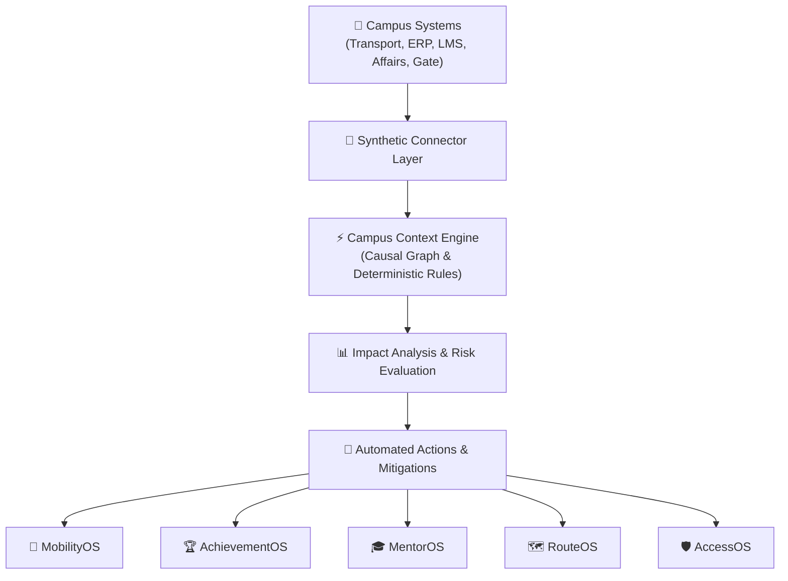

# CampusOS

> **One campus. One context. Connected decisions.**

CampusOS is a unified, software-only campus operating system built for Google Solution Hunt Challenge 2026 Problem Statement PS02: *“When Systems Don't Understand Each Other.”*

Instead of operating five isolated, siloed university applications, CampusOS connects campus events to real-world consequences across physical transport, academic timetables, LMS learning telemetry, extracurricular On-Duty approvals, and turnstile access control.

---

## 🎯 Problem Statement (PS02)

In modern universities, software systems operate in silos:
- When a campus bus gets stuck in traffic on an outer highway corridor, the **Transport System** knows the bus is delayed, but the **Academic ERP** marks 42 students absent for an 8:45 AM laboratory exam.
- When students win a national hackathon, the **Student Affairs Desk** verifies their victory, but the **Biometric Attendance System** flags them for attendance shortages.
- When a student fails a data structures quiz, the **LMS** logs a low score, but the **Faculty Calendar** does not suggest available office-hour support slots.
- When a gate security guard inspects a student turnstile hold, traditional systems reveal private financial or academic reasons to security personnel.

**PS02 Core Challenge:** *Systems record events, but fail to understand or coordinate their cross-domain consequences.*

---

## 💡 Solution

CampusOS introduces a central **Campus Context Engine**—a deterministic rule-graph pipeline that ingests events from campus connectors, synthesizes cross-domain context, evaluates user impact, recommends mitigation protocols, and dispatches automated actions across five specialized sub-modules.



---

## 🧩 Core Modules

| Module | Primary Focus | Key Capability |
| :--- | :--- | :--- |
| **MobilityOS** | Live Bus GPS & Commute Intelligence | Driver GPS broadcasting, nearest SRM-AP boarding point calculation, AI bus recommendation, and live Leaflet GIS map. |
| **AchievementOS** | Extracurricular & Academic Compliance | 5-step automated On-Duty (OD) pass generation, timetable scanning, and attendance credit updates. |
| **MentorOS** | Learning Telemetry & Early Support | Identifies quiz concept gaps (e.g. *Linked Lists* at 38%), matches faculty office hours, and schedules 1-on-1 micro-mentoring. |
| **RouteOS** | Spatial GIS & Detour Intelligence | Crowdsourced and driver road hazard reporting with automated alternative detour vector calculations. |
| **AccessOS** | Zero-Leak Physical Security | Privacy-first gate access control projecting high-level `ALLOW`, `VERIFY`, or `DENY` status while protecting confidential academic records. |

---

## 🏗️ System Architecture

$$\text{SRM-AP Systems} \;\longrightarrow\; \text{Synthetic Connectors} \;\longrightarrow\; \text{Event Ingestion} \;\longrightarrow\; \text{Context Engine} \;\longrightarrow\; \text{Impact Graph} \;\longrightarrow\; \text{CampusOS Modules} \;\longrightarrow\; \text{Users}$$

1. **Event Ingestion**: Receives live GPS feeds, contest verification payloads, quiz sub-scores, or turnstile scans.
2. **Context Synthesis**: Cross-references student timetables, lab rosters, faculty calendar availability, and route corridors.
3. **Impact Analysis**: Computes exact user counts, affected classes, transit delay minutes, and attendance breach risks.
4. **Action Dispatch**: Executes automated reroutes, OD certificates, LMS tutorial pushes, or turnstile holds.

---

## 🌟 Key Features

- 🚌 **Live Bus GPS System**: Supports both **Driver Mode** (real-time position broadcasting) and **Student Mode** (nearest stop detection and route arrival tracking).
- 📍 **SRM-AP Real-World Map Basis**: Centered on SRM University-AP (Neerukonda Campus) with verified route corridors (*Vijayawada*, *Guntur*, *Mangalagiri*, *Tadepalli*, *Undavalli*, *Tenali*).
- 🔄 **5-Step Causal Event Cascade**: Triggers visual step-by-step impact chains from initial event to final resolution.
- 🛡️ **Zero-Leak Privacy Control**: Gate turnstiles display simple `ALLOW`, `VERIFY`, or `DENY` status without exposing private student reasons to security staff.
- 🔄 **Offline / Demo GPS Fallback**: Operates smoothly with real-time Firebase Realtime Database or built-in simulated GPS route streams if Firebase or browser permissions are unconfigured.

---

## 🛠️ Technology Stack

- **Frontend**: React 18, TypeScript, Vite
- **Styling & UI**: Tailwind CSS, Google Four-Color Semantic Palette (`#4285F4`, `#EA4335`, `#FBBC05`, `#34A853`), Times New Roman Typography
- **Icons**: Lucide Icons, Material Symbols
- **GIS & Mapping**: Leaflet.js, OpenStreetMap, Custom Styled DivIcons
- **State & Engine**: React Context API, Campus Context Engine (Deterministic Rule Graph)
- **Backend / Realtime**: Firebase Realtime Database (Optional Sync)

---

## ⚠️ Prototype Data Disclaimer

> **Notice:** This hackathon prototype uses synthetic connector data and publicly available SRM-AP information where applicable. It does not claim live access to private SRM-AP production systems. All route names, boarding points, and campus coordinates represent seed demonstration data for evaluation purposes.

---

## 🚀 Running Locally

### Prerequisites
- Node.js (v18 or higher recommended)
- npm

### Installation & Setup

1. **Clone the Repository**:
   ```bash
   git clone <repository-url>
   cd GDG_
   ```

2. **Install Dependencies**:
   ```bash
   npm install
   ```

3. **Start the Development Server**:
   ```bash
   npm run dev
   ```
   Open your browser at `http://localhost:5173` (or the port specified in terminal).

4. **Build for Production**:
   ```bash
   npm run build
   ```

---

## 🔐 Environment Variables

CampusOS is designed to run seamlessly out of the box without requiring any API keys. 

If you wish to enable optional Firebase Realtime Database live sync, copy `.env.example` to `.env`:

```bash
cp .env.example .env
```

```env
# Optional Firebase Configuration
VITE_FIREBASE_API_KEY=
VITE_FIREBASE_AUTH_DOMAIN=
VITE_FIREBASE_DATABASE_URL=
VITE_FIREBASE_PROJECT_ID=

# Optional Google Maps API Key (Leaflet active by default)
VITE_GOOGLE_MAPS_API_KEY=
```

---

## 🎬 5-Second Hero Demo Flow

To demonstrate the core PS02 solution to judges in 5 seconds:

1. Open **CampusOS** at `http://localhost:5173`.
2. Click **`[ ⚡ SIMULATE BUS DELAY ]`** in the top header or home card.
3. Observe the **5-Step Context Cascade**:
   - **Step 1 (Event)**: Driver reports Bus 07 delayed 18 min on NH16 Kaza Tollgate bypass.
   - **Step 2 (Context)**: CampusOS cross-references CSE Dept 8:45 AM Object-Oriented Lab session.
   - **Step 3 (Impact)**: 42 students affected; 14 students risk crossing &lt;75% attendance threshold.
   - **Step 4 (Recommendation)**: CampusOS recommends rerouting students to Bus 12.
   - **Step 5 (Action)**: Automated SMS notification sent to students; LMS applies grace period lock exemption automatically.

---

## 👥 Team

- **Team Lead / Full Stack Developer** — *Ganesh Pirinti*
- **Frontend / UI Engineer** — *Team Member 2*
- **Context Engine Architect** — *Team Member 3*
- **GIS / Telematics Specialist** — *Team Member 4*
- **Domain & Compliance Researcher** — *Team Member 5*

---

## 📄 License

This project is licensed under the [MIT License](LICENSE).
